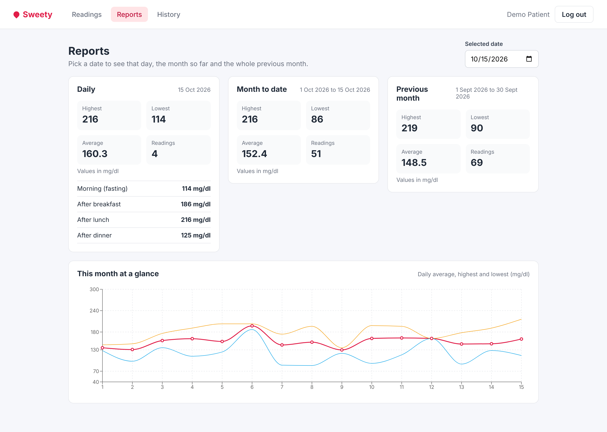

# Sweety: blood glucose tracker

Sweety is a small web app where a person with diabetes records up to four blood glucose readings a day and checks daily, month-to-date and monthly reports.

Built with **Node.js + Express**, **PostgreSQL** and **React (Vite)** for the Kenpath Junior Full Stack Developer assignment.



## Features

**Required**

- Sign up with name, email and password, then log in. Passwords are hashed with bcrypt. A JWT is issued on login and every readings and reports query is scoped to the logged-in user.
- Add, view, edit and delete readings. Each reading has a date, a time slot (Morning (fasting), After breakfast, After lunch, After dinner) and a value in mg/dl.
- Validation on both the client and the API, with the exact messages from the brief:

  | Rule | Message |
  | --- | --- |
  | Value is required | Please enter a glucose value. |
  | Whole number between 40 and 600 | Value must be between 40 and 600 mg/dl. |
  | One reading per slot per day | You already have an After lunch reading for this date. |
  | Maximum 4 readings per day | You can add only 4 readings per day. |
  | Date cannot be in the future | Date cannot be in the future. |

- Reports with highest, lowest, average (1 decimal) and count, plus a friendly empty state:
  - **Daily**: the selected date, with every reading and its slot
  - **Month to date**: the 1st of the month up to the selected date
  - **Monthly**: the whole previous month

**Bonus tasks done**

- Pagination on `GET /api/readings?page=1&limit=20` (History page)
- Line chart of the month with Recharts (daily average, highest and lowest)
- `docker-compose.yml` that starts PostgreSQL
- Frontend tests for the reading form with React Testing Library

## Project structure

```
.
├── server/                 Express API
│   ├── src/
│   │   ├── app.js          Express app (routes, middleware)
│   │   ├── index.js        Starts the server
│   │   ├── config.js       Reads environment variables
│   │   ├── db/             Pool, schema.sql, migrate and seed scripts
│   │   ├── middleware/     JWT auth and error handling
│   │   ├── routes/         auth, readings, reports
│   │   ├── services/       Validation, readings and reports queries
│   │   └── utils/          Dates, slots, error class
│   └── tests/              Jest + Supertest API tests
├── client/                 React app (Vite)
│   └── src/
│       ├── auth/           Auth context (token in localStorage)
│       ├── components/     ReadingForm, ReadingList, ReportCard, TrendChart...
│       ├── lib/            API client, validation, date helpers
│       └── pages/          Login, Register, Readings, Reports, History
├── docs/screenshots/
└── docker-compose.yml
```

### How it fits together

- The React app calls the API under `/api`. In development Vite proxies `/api` to `http://localhost:4000`, so there are no CORS issues.
- Validation rules that only need the request body (value, date, slot) live in `server/src/services/readingValidation.js`. The rules that need the database (one per slot, four per day) are checked in `readingsService.js` before insert or update. A `UNIQUE (user_id, reading_date, slot)` constraint and `CHECK` constraints in PostgreSQL back these up, so bad data cannot get in even if two requests race.
- Reports are computed in SQL (`MIN`, `MAX`, `ROUND(AVG(value), 1)`, `COUNT`). Date ranges come from one small helper, `reportRanges(date)`, which is unit tested against the example in the brief.
- `DATE` columns are returned as plain `YYYY-MM-DD` strings so a reading never shifts by a day because of server timezones.

## Getting started

### Prerequisites

- Node.js 20 or newer
- PostgreSQL 14 or newer (local install, or Docker)

### 1. Install

```bash
git clone https://github.com/Ayush701-code-zm/sweety-glucose-tracker.git
cd sweety-glucose-tracker

cd server && npm install
cd ../client && npm install
```

### 2. Set up the database

Option A, with Docker (creates both `sweety` and `sweety_test`):

```bash
docker compose up -d db
```

Option B, with a local PostgreSQL:

```bash
createdb sweety
createdb sweety_test
```

Then configure and create the tables:

```bash
cd server
cp .env.example .env        # edit DATABASE_URL / TEST_DATABASE_URL if your credentials differ
npm run db:migrate          # creates the users and readings tables
npm run db:seed             # creates the demo user with about 60 days of readings
```

Demo login after seeding: **demo@sweety.app** / **demo12345**

### 3. Run the server

```bash
cd server
npm run dev                 # http://localhost:4000 (use npm start without file watching)
```

### 4. Run the client

```bash
cd client
cp .env.example .env        # optional, the defaults work for local development
npm run dev                 # http://localhost:5173
```

### 5. Run the tests

```bash
cd server && npm test       # Jest + Supertest against the sweety_test database
cd client && npm test       # Vitest + React Testing Library
```

The API tests truncate the test database before each test, which is why they use a separate `TEST_DATABASE_URL`.

## Environment variables

`server/.env.example`

| Variable | Purpose |
| --- | --- |
| `PORT` | API port (default 4000) |
| `DATABASE_URL` | PostgreSQL connection string for the app |
| `TEST_DATABASE_URL` | PostgreSQL connection string for the test suite |
| `JWT_SECRET` | Secret used to sign login tokens |
| `JWT_EXPIRES_IN` | Token lifetime, for example `7d` |
| `APP_TIMEZONE` | Timezone used to decide what "today" is (default `Asia/Kolkata`) |
| `CLIENT_ORIGIN` | Allowed CORS origin for the React app |

`client/.env.example`

| Variable | Purpose |
| --- | --- |
| `VITE_API_URL` | Base URL of the API (default `/api`) |
| `VITE_API_PROXY` | Where the Vite dev server forwards `/api` |

## API

All routes except register and login need `Authorization: Bearer <token>`.

| Method | Path | Description |
| --- | --- | --- |
| POST | `/api/auth/register` | `{ name, email, password }`, returns `{ token, user }` |
| POST | `/api/auth/login` | `{ email, password }`, returns `{ token, user }` |
| GET | `/api/auth/me` | Current user |
| GET | `/api/readings` | `?from=&to=&page=1&limit=20`, newest first, with `pagination` |
| POST | `/api/readings` | `{ date, slot, value }` |
| PUT | `/api/readings/:id` | `{ date, slot, value }` |
| DELETE | `/api/readings/:id` | Delete one reading |
| GET | `/api/reports?date=YYYY-MM-DD` | Daily, month to date and monthly in one call |
| GET | `/api/reports/daily` | Same, one report at a time |
| GET | `/api/reports/month-to-date` | |
| GET | `/api/reports/monthly` | |
| GET | `/api/reports/trend` | Per-day average, min and max for the month to date (chart data) |

Slot keys: `morning_fasting`, `after_breakfast`, `after_lunch`, `after_dinner`.

Validation errors return `400` (or `409` for the slot and per-day rules) with `{ error, errors: { field: message } }`, and the UI shows the message next to the field.

## Screenshots

| Screen | File |
| --- | --- |
| Sign up | [01-sign-up.png](docs/screenshots/01-sign-up.png) |
| Readings, empty state for a new user | [02-readings-empty-state.png](docs/screenshots/02-readings-empty-state.png) |
| Reports, empty state | [03-reports-empty-state.png](docs/screenshots/03-reports-empty-state.png) |
| Log in with a wrong password | [04-log-in-wrong-password.png](docs/screenshots/04-log-in-wrong-password.png) |
| Log in | [05-log-in.png](docs/screenshots/05-log-in.png) |
| Readings for today | [06-readings-today.png](docs/screenshots/06-readings-today.png) |
| Error: value required | [07-error-value-required.png](docs/screenshots/07-error-value-required.png) |
| Error: value out of range | [08-error-value-range.png](docs/screenshots/08-error-value-range.png) |
| Error: duplicate slot | [09-error-duplicate-slot.png](docs/screenshots/09-error-duplicate-slot.png) |
| Error: future date | [10-error-future-date.png](docs/screenshots/10-error-future-date.png) |
| Error: more than 4 readings a day | [11-error-max-four-per-day.png](docs/screenshots/11-error-max-four-per-day.png) |
| Reading added | [12-reading-added.png](docs/screenshots/12-reading-added.png) |
| Editing a reading | [13-edit-reading.png](docs/screenshots/13-edit-reading.png) |
| Reading updated | [14-reading-updated.png](docs/screenshots/14-reading-updated.png) |
| Reading deleted | [15-reading-deleted.png](docs/screenshots/15-reading-deleted.png) |
| Reports for today with the month chart | [16-reports-today.png](docs/screenshots/16-reports-today.png) |
| Reports for 15 Oct 2026 (the example in the brief) | [17-reports-15-oct-2026.png](docs/screenshots/17-reports-15-oct-2026.png) |
| History with pagination | [18-history-paginated.png](docs/screenshots/18-history-paginated.png) |

## Notes

### Assumptions

- **"Today"** is decided in one configured timezone (`APP_TIMEZONE`, default `Asia/Kolkata`) so the future date rule behaves the same for everyone. A production app would use the user's own timezone.
- **Four readings a day** already follows from four slots with one reading each. I still check it explicitly and show the "only 4 readings per day" message first when a day is full, because it is clearer than a duplicate slot message in that case.
- **Value** must be a whole number written with digits only, so `120.5`, `1e2` or `abc` are rejected with the range message.
- **Monthly report** always means the whole calendar month before the selected date, as in the brief (15 Oct gives 1 Sep to 30 Sep). January wraps to the previous December and February handles leap years.
- **Average** is rounded in PostgreSQL with `ROUND(..., 1)` (half away from zero).
- **Password** must be at least 8 characters. Emails are stored lowercased so `A@x.com` and `a@x.com` are the same account.
- **Sessions** use a JWT stored in `localStorage` to keep the setup simple.
- The "In range / High / Low" tag next to a reading uses common reference values (below 70 low, above 130 fasting or 180 after meals high). It is only a visual hint, not medical advice.
- Editing or deleting a reading of another user returns 404 so the API does not reveal which ids exist.

### What I would improve with more time

- Move the token to an httpOnly cookie and add refresh tokens and rate limiting on login.
- Store a timezone per user instead of one app-wide setting.
- Cache report results in Redis and clear them when a reading changes.
- A BullMQ job that logs a daily reminder for users with fewer than 4 readings.
- A doctor role that can view reports of assigned patients.
- Proper migrations (for example node-pg-migrate) instead of one idempotent schema file.
- End-to-end tests with Playwright, and CI on GitHub Actions running both test suites.
- Run the API and client in docker-compose as well, not only PostgreSQL.
